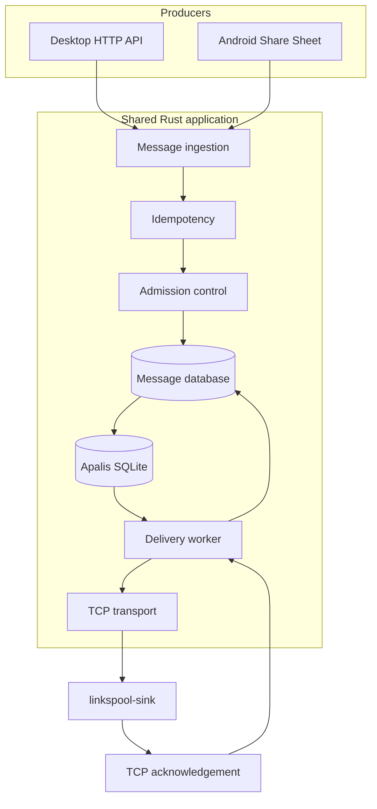
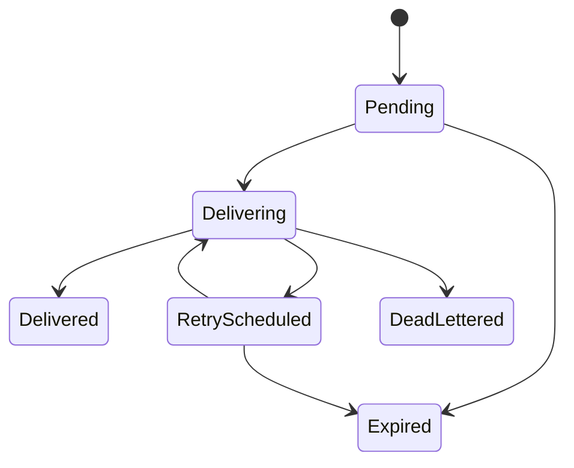

# LinkSpool

**A durable TCP message transport for unreliable networks.**

LinkSpool is a local-first transport daemon that accepts messages from applications, persists them to disk and delivers them to remote receivers over TCP.

It is designed for environments where network connectivity is intermittent, remote receivers become unavailable, and accepted messages must survive process restarts.

LinkSpool separates message acceptance from message delivery. Producers can submit data without requiring the destination to be online.

> Persist locally. Deliver reliably. Recover automatically.

## The problem

Applications operating in unreliable network environments repeatedly implement the same delivery machinery:

- Local buffering when remote services are unavailable.
- Persistent queues for outbound messages.
- Retry scheduling and backoff.
- Duplicate submission protection.
- Delivery acknowledgement tracking.
- Expiration and failed-message handling.
- Recovery after process termination.

This logic is frequently duplicated across applications and devices.

LinkSpool provides these capabilities as a reusable transport service.

It accepts messages through a local interface, maintains their delivery state and forwards them to remote receivers using a small, explicit TCP protocol.

## How it works

LinkSpool has two producer interfaces:

- **Desktop:** a local HTTP API for applications and command-line producers.
- **Android:** an Android Share Sheet target that accepts shared text and URLs from other applications.

Both interfaces submit messages to the same Rust application core.

Accepted messages are persisted before the producer receives confirmation. A background worker then delivers them to a configured TCP receiver.

### Message lifecycle

1. A producer submits a message.
2. LinkSpool validates the payload and destination.
3. An idempotency key is checked.
4. Queue capacity and message expiry are validated.
5. The message is committed to SQLite.
6. A delivery job referencing the message is enqueued.
7. The producer receives an acceptance response.
8. A worker establishes a TCP connection to the receiver.
9. The worker transmits a framed message.
10. The receiver durably records the message and returns an acknowledgement.
11. LinkSpool marks the message as delivered.

If connectivity fails, the message remains pending and is retried according to its delivery policy.

## Architecture



### Rivium

Rivium manages the application lifecycle and supervises long-running services:

- Message ingestion.
- Delivery workers.
- TCP connection management.
- Queue maintenance.
- Application health and shutdown.

The same Rust application should run as a standalone process on a laptop and as an embedded application inside Android.

### Apalis

Apalis provides durable execution of delivery work.

A job contains a message identifier, not the message payload as its authoritative copy.

The worker loads the message from the message database, checks its current state and attempts delivery.

Apalis is responsible for:
- Scheduling delivery work.
- Retrying failed jobs.
- Recovering interrupted jobs.
- Executing delayed jobs.

LinkSpool is responsible for:
- Message ingestion.
- Idempotency.
- Queue admission.
- Message expiry.
- Delivery state.
- Dead-letter handling.

LinkSpool is not another general-purpose task queue. It is a message transport with delivery semantics, using Apalis as its execution mechanism.

## TCP transport protocol

The initial transport is raw TCP, without an HTTP or TLS application stack.

A small companion program, `linkspool-sink`, runs on the laptop and receives messages.

The protocol uses length-prefixed frames.

### Frame format

Each frame starts with a four-byte unsigned big-endian length followed by the encoded payload.

```text
+----------------------+-------------------------+
| Payload length (u32) | Encoded message payload |
+----------------------+-------------------------+
         4 bytes             N bytes
```

The payload contains an envelope with:

| Field | Description |
|---|---|
| `message_id` | Stable identifier assigned by LinkSpool. |
| `idempotency_key` | Producer-supplied deduplication key. |
| `created_at` | Message creation timestamp. |
| `expires_at` | Optional message expiry timestamp. |
| `payload` | Message content. |

The initial implementation uses a versioned JSON envelope. The framing layer is independent of the serialization format so a binary encoding can be explored later.

### Acknowledgement

The receiver returns an explicit acknowledgement containing:

- Protocol version.
- Message identifier.
- Acceptance status.

An acknowledgement means the receiver has durably recorded the message, not merely read its bytes from the socket.

The sender marks the message delivered only after receiving a valid acknowledgement.

### Delivery semantics

LinkSpool provides **at-least-once delivery**.

Consider this sequence:

1. LinkSpool sends message `M1`.
2. The receiver persists `M1`.
3. The receiver sends an acknowledgement.
4. The acknowledgement is lost.
5. LinkSpool times out and retries `M1`.
6. The receiver sees `M1` again.

This duplicate is expected.

The receiver should use `message_id` as its deduplication key and return an acknowledgement for an already-recorded message.

This makes the demonstration observable: the sender retries, the receiver detects a duplicate, and the receiver avoids repeating the application-side effect.

Exactly-once delivery is not claimed.

### Security boundary

The initial TCP transport does not provide TLS or encryption.

It is intended for controlled development and trusted local networks, not exposure to untrusted networks or the public internet.

The sink should bind to an explicitly configured interface, defaulting to loopback for local development. Production network exposure, peer authentication and encrypted transport are future work.

## Message management

### Idempotency

Every submission may include an idempotency key.

If a producer repeats a request with the same key, LinkSpool returns the existing message reference rather than creating another message.

Idempotency records are scoped to a producer identity and retained for the message's defined lifetime.

### Admission control

The queue is bounded to prevent unlimited disk consumption.

Initial controls:

- Maximum message payload size.
- Maximum total queued bytes.
- Maximum queued message count.
- Explicit rejection when capacity is exhausted.

A rejected message is never reported as durably accepted.

### Expiry

Messages may have an expiry timestamp.

Expired messages must not be transmitted. Their state is updated to `expired` and they are excluded from future delivery attempts.

### Retry and dead-lettering

Failed delivery attempts use exponential backoff.

Each message has a maximum attempt count. Once that limit is reached, the message enters the `dead_lettered` state.

Dead-lettered messages remain inspectable and can be explicitly retried or discarded through an administrative operation.

### Message lifecycle



## Persistence and consistency

SQLite is the authoritative message store.

The message table owns:
- Message payload.
- Destination.
- Idempotency key.
- Creation and expiry timestamps.
- Delivery state.
- Attempt count.
- Last delivery error.

Apalis jobs contain only message identifiers.

### Atomic ingestion

Message insertion and job creation must not become two unrelated commits.

The preferred design is:

```text
BEGIN TRANSACTION

  INSERT INTO messages (...)

  INSERT INTO apalis_jobs (
      message_id,
      ...
  )

COMMIT
```

This ensures that an accepted message cannot be permanently stranded without delivery work.

The first implementation spike will verify whether `apalis-sqlite` exposes a raw-connection insertion path that can participate in the same SQLite transaction as the message insertion.

The documented `queries::push_tasks` API is a candidate. If the transaction integration cannot be established safely, use a recoverable dispatch/outbox mechanism rather than weakening the durability guarantee.

### Worker idempotency

A delivery job may execute more than once.

Before attempting transmission, the worker checks the authoritative message state.

- `delivered`: acknowledge the job without retransmission.
- `expired`: acknowledge the job without transmission.
- `dead_lettered`: acknowledge the job without transmission.
- `pending` or `retry_scheduled`: proceed according to delivery policy.

The receiver independently deduplicates by message identifier.

## Android integration

Android provides the producer interface through the system Share Sheet.

Other applications can share text or URLs directly into LinkSpool.

### Share workflow

1. A user selects text or a URL in another application.
2. They choose LinkSpool from the Android Share Sheet.
3. Android launches the LinkSpool share activity.
4. Kotlin extracts the shared content.
5. The content is passed into the Rust application through JNI.
6. The Rust core validates and persists the message.
7. The user receives confirmation that the message was accepted.

The Android application does not expose an unauthenticated loopback HTTP server. Shared content enters through the Android activity and JNI boundary.

The embedded service uses Android application-private storage for persistent message data.

The Android feature is a real producer of messages, not just a remote dashboard.

## Desktop integration

The desktop application exposes a local HTTP API for local producers.

Example:

```bash
curl -X POST http://127.0.0.1:8080/v1/messages \
  -H "Content-Type: application/json" \
  -d '{
    "destination": "local-sink",
    "idempotency_key": "event-001",
    "payload": {
      "event": "device_status",
      "status": "online"
    }
  }'
```

The endpoint returns an acceptance response only after durable ingestion succeeds.

The desktop API binds to loopback by default.

## linkspool-sink

`linkspool-sink` is a small companion TCP receiver.

Its purpose is to demonstrate the transport protocol independently of the sender.

It should:

- Listen on a configurable TCP address.
- Read length-prefixed frames.
- Validate protocol versions and message envelopes.
- Persist received message identifiers and payloads.
- Detect duplicate message identifiers.
- Return explicit acknowledgements.
- Support an option to intentionally drop acknowledgements.
- Display received and duplicate message counts.

The sink uses SQLite for its receiver-side deduplication records.

### Demonstration: lost acknowledgement

```text
LinkSpool                         linkspool-sink

    |                                  |
    |-------- MESSAGE M1 ------------>|
    |                                  | Persist M1
    |<------- ACK M1 ------------------|
    |          ACK LOST                |
    |                                  |
    |-------- MESSAGE M1 ------------>|
    |                                  | Detect duplicate
    |<------- ACK M1 ------------------|
    |                                  |
    | Mark M1 delivered                |
```

This demonstrates why TCP connection success is not equivalent to application-level delivery acknowledgement.

## Technology stack

| Component | Technology |
|---|---|
| Core application | Rust |
| Async runtime | Tokio |
| Service lifecycle | Rivium |
| Background processing | Apalis |
| Job persistence | Apalis SQLite |
| Message persistence | SQLite |
| Desktop API | Axum |
| Transport | TCP |
| Framing | Four-byte big-endian length prefix |
| Initial serialization | JSON |
| Android integration | Kotlin + JNI |

Rust 1.92 or later is required by the current Rivium toolchain documentation. Exact dependency versions will be pinned in `Cargo.toml` and `Cargo.lock`.

## Project structure

```text
linkspool/
├── Cargo.toml
├── Cargo.lock
├── rust-toolchain.toml
├── README.md
├── migrations/
├── crates/
│   ├── linkspool-core/
│   ├── linkspool-protocol/
│   └── linkspool-sink/
├── src/
│   ├── main.rs
│   ├── app.rs
│   ├── api/
│   ├── ingestion/
│   ├── message/
│   ├── delivery/
│   ├── transport/
│   ├── persistence/
│   └── jobs/
└── android/
    └── app/
```

The crate boundaries are intended to keep the protocol and message core independent of the Android integration.

## Running

### Prerequisites

- Rust 1.92 or later.
- Cargo.
- Android Studio and Android SDK for the Android build.
- Android NDK and required Rust Android targets.

### Desktop

```bash
git clone https://github.com/YOUR_USERNAME/linkspool.git
cd linkspool
cargo run
```

### Start the sink

```bash
cargo run -p linkspool-sink
```

### Android

Open the Android project in Android Studio, build and install it on an Android device or emulator.

Share text or a URL from another application into LinkSpool.

The embedded Rust application should retain accepted messages across application restarts.

## MVP scope

### Included

- Rust application using Rivium.
- Android Share Sheet integration.
- Desktop loopback HTTP ingestion API.
- SQLite message persistence.
- Producer idempotency keys.
- Bounded queue admission.
- Message expiry.
- Maximum delivery attempts.
- Exponential retry backoff.
- Dead-letter state.
- Apalis durable delivery jobs.
- Raw TCP transport.
- Length-prefixed protocol frames.
- Explicit receiver acknowledgements.
- `linkspool-sink` companion application.
- Receiver-side duplicate detection.
- Desktop execution through `cargo run`.
- Android embedded execution through JNI.

### Excluded

- TLS.
- MQTT, AMQP and HTTP delivery adapters.
- Priority queues.
- Batch ingestion.
- Multi-destination routing.
- Distributed broker clustering.
- Exactly-once delivery.
- Complex metrics and monitoring dashboards.
- Public internet exposure.

## Demonstration plan

The demonstration should prove the transport's reliability properties.

1. Start `linkspool-sink`.
2. Start LinkSpool.
3. Submit a message through the desktop HTTP API.
4. Verify that the sink receives and persists it.
5. Stop the sink.
6. Submit another message and verify that LinkSpool retains it.
7. Restart LinkSpool and confirm that the pending message survives.
8. Restart the sink and verify eventual delivery.
9. Configure the sink to drop an acknowledgement.
10. Observe LinkSpool retransmit the same message.
11. Verify that the sink identifies the duplicate and does not repeat its application-side effect.
12. Submit the same idempotency key again and verify that LinkSpool does not create another message.
13. Exceed the configured attempt limit and verify dead-lettering.
14. Share a URL from another Android application into LinkSpool and verify persistence.

## Design principles

- Persist before acknowledging producers.
- Explicitly define delivery guarantees.
- Keep one authoritative message record.
- Use Apalis for execution, not message ownership.
- Make retries safe.
- Treat duplicate delivery as normal.
- Bound resource consumption.
- Never silently discard accepted messages.
- Make failure and recovery observable.

## References

- [Rivium documentation](https://docs.rs/rivium/latest/rivium/)
- [Rivium JNI](https://docs.rs/rivium-jni/latest/rivium_jni/)
- [Apalis overview](https://apalis.dev/docs/introduction/overview)
- [Apalis architecture](https://apalis.dev/docs/introduction/architecture)
- [Apalis SQLite](https://github.com/apalis-dev/apalis-sqlite)
- [Rivium Challenge](https://github.com/apalis-dev/rivium-challenge)

---

**LinkSpool — Durable delivery over unreliable networks.**
